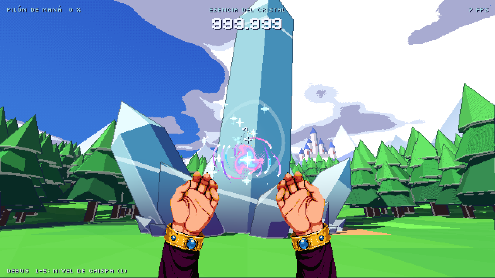

# Can you destroy it?

Un incremental mágico en primera persona y pixel art, hecho en **Godot 4.7**. En el valle ha brotado un cristal de maná gigantesco y tú solo tienes una chispita. Golpéalo, recoge los pedazos, llena el Pilón de Maná y conviértete en el mago capaz de destruirlo.

- Proyecto Godot 4.7: abrir [`game/project.godot`](game/project.godot)
- Diseño: [`Can_You_Destroy_It_GDD.pdf`](Can_You_Destroy_It_GDD.pdf)
- Contexto y guías para agentes y desarrolladores: [`AGENTS.md`](AGENTS.md)
- Referencias visuales: [`docs/referencias/`](docs/referencias/)

## Jugar el prototipo

Abre `game/project.godot` con Godot 4.7 y pulsa F5.

| Acción | Control |
|---|---|
| Empezar / capturar ratón | Clic |
| Mirar / moverse | Ratón / WASD |
| Lanzar chispa (mano izq. / der.) | Clic izquierdo / derecho |
| Recoger fragmento (mantener: en cadena) | F |
| Soltar el ratón | Esc |
| Nivel de chispa (sólo debug) | 1 a 5 |

Historial de cambios en [`CHANGELOG.md`](CHANGELOG.md).



## Regenerar el GDD

```bash
python3 tools/make_gdd.py Can_You_Destroy_It_GDD.pdf
```

Requiere `reportlab` y `Pillow`.

## Regenerar los sonidos

```bash
python3 tools/sfx_synth.py
```

Requiere `numpy`, `scipy` y `ffmpeg`.
